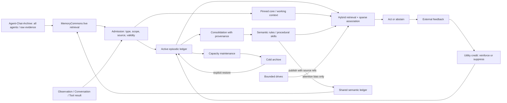

# hippomind 记忆系统调研与最终架构

> 调研日期：2026-08-15。目标不是复刻某个框架，而是为「纯 Python、无外部依赖的海马体 + 驱力引擎」提取有用且可验证的最小架构。

## 一、结论先行

记忆系统最重要的不是「存了多少」，也不是「有多少种打分」，而是一套可审计的记忆生命周期：

1. **形成质量**：什么值得写；事实、经历、技能、临时状态不能混为一类。
2. **真实性与证据**：每条记忆要有来源、时间、有效期和替代关系；新事实不应把旧证据直接删掉。
3. **信用分配**：「被召回」不等于「帮助了行动」。必须等环境/用户/评测器反馈后才大幅升权或降权。
4. **精准召回与弃权**：检索应同时看语义、关键词、时间、图关系、可用性；证据不足时必须允许「不知道」。
5. **容量预算与归档**：活跃区必须有硬上限。遗忘首先是从活跃检索池退到冷归档，而不是一步永久删除。
6. **可观测与评测**：必须能回答「为什么召回这条」、「哪条记忆导致错误」，并用长期更新、时间推理、弃权和真实任务收益验收。

心潮驱力的正确边界是：**驱力可以影响注意力与探索顺序，但不能改变事实的真伪、证据的来源、或跳过外部反馈。**

## 二、38 个相关项目与基准

| # | 项目 | 最有价值的设计 | 对 hippomind 的结论 |
|---:|---|---|---|
| 1 | [xinchao-nian](https://github.com/tianyupaipai-cmd/xinchao-nian) | 驱力时间地板、记忆共振、梦境安全化、Ombre Brain 策略门 | 保留有界驱力闭环；借鉴其「梦不冒充真实记忆」和检索门控 |
| 2 | [Letta / MemGPT](https://github.com/letta-ai/letta) | 核心记忆常驻上下文，长期记忆按需读取，状态全量持久化 | 区分 pinned core memory 与可检索长期记忆；后台梦境只负责巩固 |
| 3 | [Mem0](https://github.com/mem0ai/mem0) | 用户/会话/Agent 多层隔离，语义 + BM25 + 实体 + 时间多信号检索 | 加入 scope/source；长期应使用混合检索，不能只有向量/特征距离 |
| 4 | [Graphiti](https://github.com/getzep/graphiti) | 事实有有效时间窗，新事实使旧事实失效但不删除；源 episode 谱系 | 实现 valid_until/superseded_by/source；冲突用时间有效性处理 |
| 5 | [Zep](https://github.com/getzep/zep) | 生产级用户/会话隔离、时态图、可复现评测 | 学习其评测和多租户边界；不引入云服务依赖 |
| 6 | [Hindsight](https://github.com/vectorize-io/hindsight) | World facts / Experiences / Mental models 三通道，Retain/Recall/Reflect 三操作 | 情景经验与语义心智模型必须分层；反思不能写回原始事实 |
| 7 | [OpenViking](https://github.com/volcengine/OpenViking) | 资源、技能、记忆统一上下文数据库，层级组织与会话自动提交 | 未来增加独立 procedural/skill 层；不把所有东西塞进 episode |
| 8 | [TencentDB Agent Memory](https://github.com/TencentCloud/TencentDB-Agent-Memory) | 对话记忆、技能、Wiki、CodeGraph 四种资产；所有权、版本、可见性 | 证明「记忆是可治理资产」；后续增加权限与版本，不只有一个 JSON 池 |
| 9 | [A-MEM](https://github.com/agiresearch/A-mem) | Zettelkasten 原子笔记、动态链接、上下文/标签演化 | 借鉴增量联系，但联想必须稀疏且有容量上限 |
| 10 | [AgenticMemory 实验库](https://github.com/WujiangXu/AgenticMemory) | A-MEM 的论文复现与对比评测 | 存储结构的演化需要任务评测，不能只看可视化图是否复杂 |
| 11 | [HippoRAG](https://github.com/OSU-NLP-Group/HippoRAG) | 开放知识图作为海马索引，PPR 从查询概念做联想扩散 | 联想图用于跨记忆联结，但候选仍需直接相关性门槛，不让图漫游污染结果 |
| 12 | [MemOS](https://github.com/MemTensor/MemOS) | 统一记忆 API、记忆 cube 隔离与共享、反馈修正、异步调度 | 接口应支持纠错/替代/恢复；未来从 JSON 迁到 SQLite/WAL |
| 13 | [MemoryOS](https://github.com/BAI-LAB/MemoryOS) | 短期、中期、长期分层存储，Storage/Update/Retrieve/Generate 四模块 | 当前活跃 episode / semantic / archive 三层正确；必须继续保持模块边界 |
| 14 | [MIRIX](https://github.com/Mirix-AI/MIRIX) | Core/Episodic/Semantic/Procedural/Resource/Knowledge Vault 六种记忆 | 验证独立技能与资源层的必要性；本轮先保持轻量三层 |
| 15 | [Cognee](https://github.com/topoteretes/cognee) | 图 + 向量、本地持久、remember/recall/forget/improve、审计与租户隔离 | 接口动词清晰；改善不应覆写原始证据 |
| 16 | [GoodAI-LTM](https://github.com/GoodAI/goodai-ltm) | 切块、查询重写、重排、块扩展组成完整对话记忆流 | 未来文本模式增加查询重写与重排；网格特征不需要文本 chunking |
| 17 | [Memvid](https://github.com/memvid/memvid) | append-only 不可变帧、校验和时间旅行、单文件便携 | JSON 应原子替换并保留谱系；生产版应使用 append-only WAL |
| 18 | [Generative Agents](https://github.com/joonspk-research/generative_agents) | relevance + recency + importance 召回，累积重要性触发 reflection，再用于 planning | 保留四维打分，但将 reflection 与原始经验分层；不让召回热度无限强化 |
| 19 | [AI Town](https://github.com/a16z-infra/ai-town) | 可部署多 Agent 社会仿真与向量记忆 | 是行为验证场，不是记忆真实性/冲突处理的完整答案 |
| 20 | [LangGraph](https://github.com/langchain-ai/langgraph) | durable execution、checkpoint 短期状态、跨会话长期 store | 运行时状态与长期记忆不能混淆；恢复任务不等于语义回忆 |
| 21 | [LangChain](https://github.com/langchain-ai/langchain) | 对话缓冲、摘要、检索器和外部 store 的组合式接口 | 适合作为集成层；不应让框架的 buffer 等同于长期记忆 |
| 22 | [LlamaIndex](https://github.com/run-llama/llama_index) | 文档索引、多存储后端、持久化与重排 | 值得借鉴检索接口；它更偏文档 RAG，不替代经验信用分配 |
| 23 | [AutoGen](https://github.com/microsoft/autogen) | 多 Agent 消息/状态编排 | 学习多 Agent 集成边界；项目已进入维护模式，不作新架构核心依赖 |
| 24 | [Semantic Kernel](https://github.com/microsoft/semantic-kernel) | 插件、向量库连接器、Agent 状态与企业治理 | 未来用 adapter 替换存储/检索后端，核心生命周期不绑定某个 DB |
| 25 | [CrewAI](https://github.com/crewAIInc/crewAI) | 角色化 Agent、流程状态和可配置 memory | 适合验证跨 Agent 共享，但需 scope 与 ACL 防止记忆串租户 |
| 26 | [CAMEL](https://github.com/camel-ai/camel) | 大规模多 Agent 与 stateful memory | 数量扩展会放大容量/隔离问题，因此必须先有硬预算和 scope |
| 27 | [Agno](https://github.com/agno-agi/agno) | session/memory/knowledge/trace 分开存储，多租户与可观测 | 记忆与 trace 分离；不要把每个工具日志都当长期记忆 |
| 28 | [Eliza](https://github.com/elizaOS/eliza) | memory/state 原语、插件合约、本地推理 | 验证记忆 API 应与模型无关；个性状态与事实记忆要分开 |
| 29 | [AutoGPT](https://github.com/Significant-Gravitas/AutoGPT) | 长任务运行、自动化流程和资源连接 | 它是任务平台，不是记忆学习的对照真值；应用任务收益验证记忆 |
| 30 | [Agent Zero](https://github.com/agent0ai/agent-zero) | 项目级文件、指令、密钥和 memories 隔离 | 项目级 scope 是必要的；敏感配置不应进入普通可检索记忆 |
| 31 | [OpenHands](https://github.com/OpenHands/OpenHands) | 编码 Agent 任务轨迹与恢复 | 将来应存「验证过的修复策略」而不是整段原始 shell 日志 |
| 32 | [Langroid](https://github.com/langroid/langroid) | 消息驱动多 Agent 编程和检索增强 | 作为外部集成参考；不从框架接口反推核心数据模型 |
| 33 | [GraphRAG](https://github.com/microsoft/graphrag) | 实体关系抽取、社区摘要、全局/局部图查询 | 适合静态知识库；对频繁变化的 Agent 事实需另加时态失效机制 |
| 34 | [LightRAG](https://github.com/HKUDS/LightRAG) | 轻量实体-关系图与多存储后端 | 可作为可选知识图后端；当前纯 Python 演示先使用稀疏 Association |
| 35 | [General Agentic Memory](https://github.com/VectorSpaceLab/general-agentic-memory) | 层级文件系统、LLM 分段、TLDR、任务轨迹压缩 | 长轨迹应压缩成可验证的经验/技能，不应通过高 touch 永久保留 |
| 36 | [LoCoMo](https://github.com/snap-research/locomo) | 超长多会话 QA、事件摘要和证据标注 | 用于验收长期对话召回与证据定位 |
| 37 | [LongMemEval](https://github.com/xiaowu0162/LongMemEval) | 信息抽取、跨会话推理、知识更新、时间推理、弃权 | 是比「召回了吗」更完整的核心验收集 |
| 38 | [Agent Memory Leaderboard](https://github.com/AML-memory/agent-memory-leaderboard) | 统一多记忆系统比较 | 评估要报告模型、token 预算、延迟和检索上限，不盲信单一自报分数 |

当前发布契约：Context Pack 最多 8 项、默认 6000 token，并受 16000 字符运输上限约束；raw chat 默认不输出。Schema v5 会隔离由 raw chat 启发式派生但未独立验证的内容。

## 三、最终架构

### 数据层

- **Core / Working**：人格、当前目标、必须常驻的用户约束；小、可编辑、可 pinned。
- **Episodic**：原始经验账本，保留情境、行动、结果、情感、来源和有效期。
- **Semantic**：多条可追溯 episode 提炼的稳定规则；支持数和置信度必须可见。
- **Procedural**：可验证的步骤、工具使用和技能；下一阶段独立出来。
- **Archive**：不参与常规检索的冷证据，保留恢复和审计能力。

### 运行规则

1. 开始行动前召回，召回只小幅度再巩固。
2. 只有真正参与决策的记忆获得信用，且信用来自外部结果。
3. 同一情境不同行动必须分开存储，否则奖励会串扰。
4. 驱力偏置是有界乘数，必须先通过 topic 相关性门槛。
5. 联想只保留 top-N 邻居和最大度数，扩散结果还要有直接相关分。
6. 已巩固情景更容易进归档，因为其可用规律已经进入 semantic 层。
7. 新事实通过 supersede 让旧事实失效，但保留谱系；过期记忆不参与召回。
8. 梦境/反思不得伪装成现实事件，不得因为「梦到」而反向升权。

## 四、本轮已落地

- 动作感知去重：去重键从情境改为「情境 + action + scope」。
- 证据字段：`observation_count / confidence / utility / success_count / failure_count / source / scope / valid_until / superseded_by / pinned`。
- 召回与效用分离：召回小幅饱和升权，`reinforce()` 根据外部结果更新 utility。
- 中文无依赖检索：英文词 + CJK 字/bigram Jaccard，不再把整句中文当一个 token。
- 时间有效性与替代：过期/被替代记忆不进检索池。
- 三层存储：活跃 episode 最多 180，semantic 最多 96，archive 最多 600。
- 安全梦境：每条经验只消化一次，不增加 touch 或 weight。
- 增量巩固：只处理未巩固证据，相似规则增量更新，证据 ID 去重。
- 稀疏联想：每条新记忆最多 4 条相似边，每节点最大度 8，使用邻接索引。
- 原子持久化：v3 JSON 用临时文件 + `fsync` + `os.replace`，并向后兼容 v2。
- LLM 两阶段反馈：`run_task()` 不再把模型自评写成真实经验；`record_feedback()` 接收外部结果后才入库。
- 指标拆分：直接记录 food/poison/wall/return，不再用塑形奖励的正负充当「Accuracy」主指标。
- 全机联邦记忆：`MemoryCommons` 实时读取 Agent-Chat-Archive，不复制原始消息；自动发现本机主库并回退移动硬盘镜像。
- 跨 Agent 共享账本：经过巩固的规则必须带 `source_ref` 才能发布；支持外部反馈、有效期和 supersede。
- 召回准入门：默认只读 user/assistant，排除审批转录、环境上下文、工具输出和推理样板，但不删除原始证据。
- 层状海马网络：新增 `--mode network`，把驱力、记忆域、活跃情景、巩固规则、冷归档和共享 Agent 映射为六层真实拓扑；支持扩散高亮、节点检查、缩放、平移和学习控制。

## 五、验证结果

固定 3000 步，新库、`epsilon=0.15`：

| Seed | 记忆 Agent 觅食 | 随机觅食 | 记忆 Agent 毒药 | 活跃 episode | semantic | association | 耗时 |
|---:|---:|---:|---:|---:|---:|---:|---:|
| 42 | 42 | 10 | 1 | 9 | 93 | 29 | 2.10s |
| 7 | 30 | 5 | 1 | 6 | 71 | 18 | 1.90s |
| 123 | 27 | 10 | 1 | 64 | 96 | 167 | 2.06s |
| **平均** | **33.0** | **8.3** | **1.0** | **26.3** | **86.7** | **71.3** | **2.02s** |

原版 seed=42 的已知结果是 23 次觅食、252 条活跃情景、81 条规则、3454 条联想；修改后同种子为 42 次觅食、9 条当前活跃情景、93 条语义规则、29 条联想。冷归档保留最多 600 条证据，不参与常规决策。

共通层在本机真实归档上验证：8 类 Agent、123,602 条消息、187 个会话可见；查询
`记忆系统 Agent 互通` 的端到端耗时约 0.12 秒。自动化测试共 15 项，覆盖实时增量可见、
Agent/role 过滤、噪声门控、带证据发布、共享反馈、替代和幂等提升。

GUI 的无窗口 100 帧基准从 14.2 FPS 提高到 23.9 FPS：世界保持逐帧刷新，记忆网络/
驱力隔帧刷新，统计和权重曲线低频刷新；学习步频与记忆语义不变。

新增层状网络在 174 个可见节点、508 条真实连接的 60 帧基准中达到 26.8 FPS；
1920×1080 截图验证包含 212 个节点、582 条连接和 6 个完整生命周期层。
界面内的 `Y / Sync` 会把最近的带证据共享规则有界、幂等地提升进当前海马体；
`I / Init` 只初始化共通账本，并保证不清空现有记忆。

v0.4.1 将全部可见操作文案统一为简体中文，并将直线关系改为批量二次贝塞尔曲线。
在同一份 553 条真实关系上测试 `0.06 / 0.10 / 0.14 / 0.18 / 0.22 / 0.28`
六组曲率：`0.18` 的栅格热点 P95 为 10.0、边缘越界 0.7%；`0.22` 的热点不再下降，
越界增至 1.1%，所以最终采用 `0.18`。曲线方向由节点位置决定、离散量由节点对稳定哈希
决定，重启后不会随机跳动。最终用 9 个采样点和每 5 帧一次的拓扑刷新平衡质量与速度；
181 个节点、507 条曲线的 60 帧完整绘制基准为 17.0 FPS。

v0.4.2 继续保持 Agent/记忆算法完全不变，只优化显示层：HUD 从反复 clear/recreate 改为
持久文本更新，六个 Button axes 合并进单一状态轨道，无变化帧跳过 canvas draw，拓扑
刷新间隔调整为 900 帧（约 30 秒）。新版视觉减少边框、弱连接亮度和标签噪声，让网络成为主画面。
181-188 个节点、507-533 条曲线的三次隔离基准为 `52.1 / 54.8 / 53.2 FPS`，中位数
`53.2 FPS`。生产 GUI 默认每 900 帧（约 30 秒）重建一次全量拓扑，避免 macOS 图形 allocator
在长时间运行中保留数十万次 `Axes.clear` 的历史分配；`--topology-refresh-frames` 可显式调节。
固定 seed 42 的 3000 步学习结果仍为觅食 42、毒药 1（随机觅食 10），
确认显示层优化未改变学习实验。

普通 `--mode gui` 的统计和权重曲线面板同样采用低频刷新，并只保留当前 Top-8 记忆的曲线历史；
已剪枝或归档的记忆会从曲线和布局缓存中移除，避免长期运行时缓存随历史记忆增长。

## 六、v0.5 深度审查与加固

本次重新核对了 [OWASP LLM01:2025 Prompt Injection](https://genai.owasp.org/llmrisk/llm01-prompt-injection/)、[AgentDojo](https://github.com/ethz-spylab/agentdojo)、
[Graphiti](https://github.com/getzep/graphiti)、[Hindsight](https://github.com/vectorize-io/hindsight)、
[Mem0](https://github.com/mem0ai/mem0) 与 [LongMemEval](https://github.com/xiaowu0162/LongMemEval)。
结论是：跨 Agent 记忆系统最危险的不是“召回不到”，而是把原始、可变、无权限边界的数据当成
可靠指令或长期事实。检索、写入、执行和外部反馈必须分开。

本轮实装：

1. **输入与反序列化边界**：情景、标签、特征、元数据、驱力和 JSON 配置均限制大小并拒绝
   NaN/Infinity；损坏的条目会被跳过，根节点无效时保持当前 Mind 不变。
2. **事务型恢复**：海马体先在候选实例中完整验证，再整体替换；保存使用唯一临时文件、fsync
   和原子替换，避免固定临时文件在多个进程之间碰撞。
3. **共享账本并发**：发布、反馈、替代使用 SQLite BEGIN IMMEDIATE，来源引用、标签、效用
   和反馈计数不会因同时写入而丢失。
4. **LLM 非可信数据隔离**：新增系统级不信任规则、结构化记忆边界、HTTP(S) 端点检查和响应
   大小限制。默认只给 LLM 本地记忆和共享规则；原始跨 Agent 聊天需要显式授权。
5. **可执行入口与文档**：项目根目录新增 start-hippomind.command；USAGE_GUIDE.md 给出
   双击启动、同步、LLM 两阶段反馈、治理和排障流程。
6. **测试**：自动化测试从 15 项扩展到 18 项，新增异常 JSON、非有限数值、事务恢复、来源格式
   和 LLM 原始聊天默认隔离检查。

剩余的生产化风险必须明确保留：

- 共享 SQLite 仍以同一 OS 用户的文件权限为边界，不是签名、ACL 或多租户服务；
- source_ref 能追溯来源，但不能证明内容真实；关键事实仍需原始系统或人工核验；
- 提示注入只能降低影响面，不能代替工具权限、审批与最小权限执行；
- JSON 原子保存避免损坏但不合并两个独立实例的并发修改，多个 Agent 应使用独立本地文件或升级
  到下一阶段的事件账本；
- 当前无依赖检索对改写、长文与实体消歧仍有限，需要保留关键词证据并逐步引入可选重排。

固定 seed 42、3000 步回归仍为记忆 Agent 觅食 42、毒药 1；随机策略为觅食 10、毒药 9、
撞墙 576，证明本轮安全和持久化改动未改写学习实验。

## 七、v0.6 本机 Memory Hub 落地

v0.5 的 JSON 快照适合单 Agent 的 Grid World 演示，但不应作为多 Agent 事实来源。v0.6 将长期共享状态独立为 SQLite/WAL 事件账本：原始事件不可由工作记忆的剪枝逻辑静默删除，`memories` 只承载权重、触碰、效用、归档、替代和过期等可恢复投影。现有 `hippocampus_memory.json` 保持兼容导入导出，不会被后台服务覆盖。

检索层以结构化 task/project/source/time/scope 过滤为第一优先级，之后才使用 FTS5、现有多语言文本相似度、时间、触碰、效用和置信度的混合评分。Context Pack 默认最多 8 项、6000 token 预算和 16000 字符运输上限（按需上限，不足不填充），强制证据，按任务合并并通过 MMR 做多样性重排；原始聊天默认不输出，也不作为 LLM 指令。注入可按 Agent 独立开关，关闭只停止送入模型，不停止采集、巩固和维护。

运行层新增 loopback-only `hippomindd`、CLI、HTTP 和 MCP stdio 接口。watcher 使用已持久化的游标低频读取 Agent-Chat-Archive 的消息、任务和结果，单一来源出错不影响其余来源。GUI 仍是独立、按需的 matplotlib 进程，读取 daemon 状态但不承担服务职责，因此固定 seed 的 Grid World 行为不受 Memory Hub 改造影响。

最终本机复测：seed=42、3000 步 headless 仍为觅食 42、毒药 1、撞墙 0、平均回报 `+0.0237`；运行 `2.53s real`、最大 RSS `16.5 MiB`，与改造前的核心结果完全一致。关闭 watcher 的临时 daemon 空闲 RSS 约 `18.9 MiB`。短时隔离压力测试以 3 个并发 writer、12 条批量写入运行 1 秒，写入 4,572 条事件（`4,543.6 writes/s`），随后完成 100 次 Context Pack、维护和重开验证；FTS/WAL 与事件数均一致。

完整运行、隐私、迁移和排障文档见 [MEMORY_HUB_GUIDE.md](MEMORY_HUB_GUIDE.md)。

## 七点五、v0.7.x 增补：DSH 原生接入、会话采集与 Provider 自动发现

**接入分级**。Provider Manifest（`hippomind/provider_manifest.py`）声明每个已知运行时的检测标记与接入层级：`native_hook`（Codex UserPromptSubmit）> `native_plugin`（DSH Cordis 插件）> `mcp`（Pi 的 `pi-mcp-adapter`、Claude/Cursor/Gemini 以及通用 MCP 入口）> `rules`（全部已支持 Agent 的托管规则兜底）。Pi 的 adapter 原生读取 `~/.pi/agent/mcp.json`，因此安装器不再伪造 `settings.json` 键；若 adapter 未安装，状态会报告原因并保留规则回退。**真实 MCP 注册**（`hippomind/mcp_register.py`）：Pi 写 `~/.pi/agent/mcp.json`、Claude 写 `~/.claude.json` 顶层 `mcpServers`、Cursor 写 `~/.cursor/mcp.json`、Gemini 写 `~/.gemini/settings.json`；此外将最小受限的 `local` 凭据写入 `~/.agents/mcp.json`，让遵循通用 MCP 路径的新 Agent 自动发现 Hub。写入只增改 `hippomind` 自己的键、外部键原样保留、无法解析或含未知字段的专用文件拒绝改写，新建文件 0600；`agent-status` 对注册命令做实际 stdio initialize + tools/list 握手（`runtime.ready`/工具数），并对 Pi 核验 adapter 已启用。安装后做运行时验证与一次自动修复（丢失符号链接/被手改的 profile 行/被删除的 MCP 注册原位复原）。未知运行时只按指令文件签名登记报告（report-only），绝不写配置。daemon 内每小时最多一次全盘发现（`AgentDiscovery`，持久化 `agent-discovery.json`，`/stats` 暴露摘要），**每次发现后执行受控自动安装**：仅触碰 manifest 已登记且检出证据齐全的运行时（下载新 Agent 后下一周期自动接入），逐项核验、失败修复一次、结果记录于 `/stats` 的 `auto_install`。

**watcher 阻塞恢复语义**（2026-08-17 P0 修复）。归档 messages 源的逐条游标推进规则：零长度 content（如归档工具写入的空 system 事件）在构建记录前跳过并推进游标（`skipped_empty` 计数入摘要与 cursor metadata）；确定性校验失败（`LedgerError`，同输入重试必然同样失败）登记 `rejected_rowids` 后跳过推进——此前两条真实源卡在 rowid=80022 的空 system 消息上永久重试，阻塞其后约 31 万条消息；仅瞬时故障（`sqlite3.Error`）保留游标重试。修复后两源一次排空至 max_rowid（390884/82150），账本 115,971 → 173,665 条。

**DSH Cordis 插件**（`integrations/dsh-plugin/` → `~/.dsh/plugins/dsh-hippomind/`，按官方 bundle 契约接入 `~/.dsh/profiles/web/package.json`）：`agent/pre-step` 以本轮真实用户要求检索 `/context-pack`，命中时把 ≤8 项、6000 token、16000 字符运输上限的有证据结果以 `<MEMORY_DATA_UNTRUSTED>` 包裹追加消息尾（两项是按需上限；近距离、静态说明保缓存命中）；子代理不注入、空结果不注入、拒绝决策透传。会话闲置 120 秒或插件卸载时，把增量写回为结构化 `progress`/`decision`/`result`（kind 由末条 assistant 的决策标记启发式决定），evidence 指向 `dsh-session://<id>#seq=a-b`。Cordis 真正调用 `apply()` 后另写一条只在 `agent:deepseek` scope 可见的健康探针，不进入共享 recall；由 `agent-status` 的 `runtime_probe.seen` 区分“部署成功”和“宿主已实际装载”。token 只从 0600 agent config 读取，日志永不输出；daemon 不可达进入 30 秒静默退避；插件任何异常不上抛（不杀 profile 启动）。

**会话文件采集**。`session.jsonl.zstd` 是流式多帧 zstd（每 flush 一帧）。`scripts/zstd-jsonl.mjs` 直接解析帧头计算精确长度（O(n)；试探法在 41MB 真实文件上退化为 O(n²) 会超时），逐帧解码；尾部写入中的残帧静默截断、非 zstd 内容报错一次、空文件视为刚创建。超 32MB 保留「头部 64KB（session 头）+ 尾部（最新轮次）」。`hippomind/dsh_sessions.py` 按"一个真实用户消息 + 其后 assistant 回复"切轮次：content ≤4000 字符、每会话 200 轮、event_id=`dsh:<session>:turn:<seq>` 天然幂等增量；source.kind≠user 的注入消息（含本库记忆包）与含 `<MEMORY_DATA_UNTRUSTED>` 的文本永不回灌——杜绝"注入→归档→再注入"反馈循环。采集物是 `raw_chat` 不可信证据：可检索、可提炼、永不自动注入。

**实测**（2026-08-16）：40 个真实会话（最大 41.6MB 压缩/0.7s 解码）→ 23 条轮次证据入真实账本；重启后游标持久零重复；daemon 空闲 0.0% CPU / 25MB RSS；六 Agent（Codex/DeepSeek/Pi/Claude/Gemini/Cursor）经各自受限凭据对同一生产 daemon 的真实跨 Agent 关键词续接全部命中且不含原始聊天。

## 七点六、v0.9.3 检索·凝练·注入·长跑 全面升级（2026-08-21）

本轮以「调研 → 实现 → 评测门槛回归」闭环推进，全部改动带测试：

1. **检索融合**：search() 引入 RRF 双通道加分（FTS 与 LIKE 各按名次贡献
   1/(60+rank)，归一化后小权重入总分）；候选稀疏时用查询中最强实体词做受限
   二次 FTS 检索；CJK LIKE 碎片从 ≥4 字下探到 ≥3 字——修复「生产数据库的端口」
   类词序差异问句完全漏召回的问题。通道候选上限 1500/600/400 约束评分成本。
2. **注入优化**：候选级近似重复硬剔除（token_sim≥0.85，MemFlow packer 实践）；
   分组 MMR 加入覆盖度奖励（PACMS 结论：覆盖未代表区域比纯去冗余更利于抽取）；
   **纯事实兜底**：无结构化 context 的记录渲染要点行，修复整组静默丢弃。
3. **凝练升级**：巩固聚类改为惊喜度加权选种（|valence|+失败+重要性 × log(观察数)，
   clawRxiv 基准显示惊喜度策略保留率显著优于时间序），种子有界把 O(n²) 降为
   O(K·n)；seed=42 基线觅食 42→49、平均回报 +0.0237→+0.0310。
4. **冲突治理**：新增 resolve_claim()——按槽位组全状态聚合（支持翻案重裁），
   胜者恢复 accepted 并补回 FTS，败者谱系指向胜者；CLI `hippomind resolve`。
5. **时间语义**：time_parse.py 解析 11 种中文时间短语为 from/to 结构化过滤，
   任务/项目过滤存在时自动撤销避免过窄。
6. **长跑稳定**：maintain() 增量扫描（重加权阈值 + 到期窗口 + 冷置年龄三条件，
   扫描量与库大小解耦）；watcher 维护周期末 WAL TRUNCATE 检查点（PASSIVE 自动
   检查点会被重叠读饿死）；空闲 >10min 触发睡眠巩固（深维护一轮）；热重载
   （reload()/admin/reload/SIGHUP）；16 处读路径确定性关闭连接。
7. **评测基准**：40 例中文 QA 四类套件（run_memory_qa_suite），首版即暴露并
   修复两个系统性召回缺陷；四项指标 1.0 作为滚动回归门槛。
8. **GUI 重构**：ui_theme.py 共享主题；层状网络深空黑底 + 辉光双层渲染 +
   星尘场 + 终端风 HUD（真实库 1080 边/192 节点）；工作台卡片式重构；
   快照键 G；多 Agent 聚焦视图。

## 八、后续可选演进

1. **Fact 与 Skill 类型**：在当前事件账本之上增加 subject/predicate/object、trigger/steps/preconditions/verification 的显式投影。
2. **独立 Fact 与 Skill 类型**：事实使用 subject/predicate/object + validity；技能使用 trigger/steps/preconditions/verification。
3. **可选嵌入与 BM25**：保留当前无依赖通道，通过 adapter 插入本地 embedding，用 RRF 融合而不替换关键词通道。
4. **检索 trace 与弃权门槛**：输出每个得分分量、过滤原因和最终证据；低于绝对阈值时返回空。
5. **LoCoMo / LongMemEval adapter**：分别验证证据召回、知识更新、时间推理和弃权。
6. **隐私与治理**：为 user/session/team scope 增加 ACL、导出、删除请求和敏感信息阻断。

最终验收不应是「记忆越来越多」，而应是：在固定存储、检索和 token 预算下，Agent 的任务收益持续提高，知识更新不返回过期答案，证据不足时会弃权，且任何记忆都能追溯到来源。
