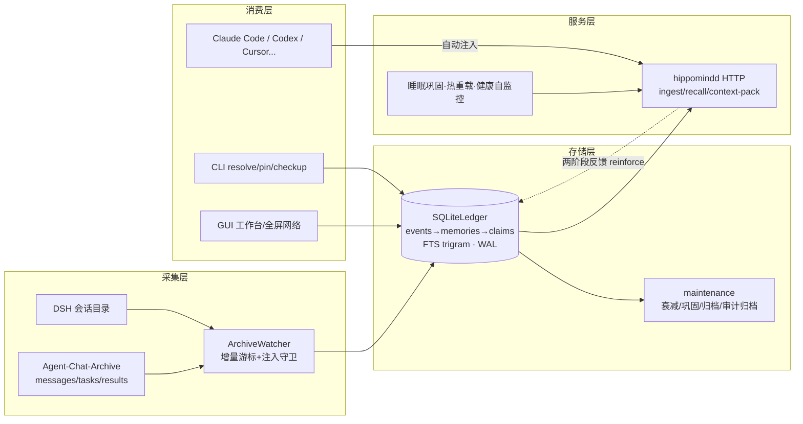

# hippomind —— 海马体实验 + 本机 Memory Hub

[](https://github.com/zps-31/hippomind/actions/workflows/ci.yml) [](LICENSE)

> 大模型是"大脑皮层"，但没有海马体，所以学不会经验。
> 本库给 Agent 外接一个类海马体的记忆系统（记忆自动**升权**/**降权**），
> 并融合 [心潮·念](https://github.com/tianyupaipai-cmd/xinchao-nian) 的动态驱力引擎，
> 形成 **欲望影响记忆、记忆影响行动** 的闭环。

完整的 38 项项目调研、设计取舍和基准见 [MEMORY_SYSTEM_DESIGN.md](MEMORY_SYSTEM_DESIGN.md)。
原有实验使用说明见 [USAGE_GUIDE.md](USAGE_GUIDE.md)；长期运行的 daemon、迁移、隐私和接入见 [MEMORY_HUB_GUIDE.md](MEMORY_HUB_GUIDE.md)。跨电脑安装、恢复和安全迁移见 [docs/PORTABILITY.md](docs/PORTABILITY.md)；发布前检查和 GitHub 发布清单见 [docs/RELEASE.md](docs/RELEASE.md)。
第一次阅读建议从 [详细拆解指南](docs/DETAILED_GUIDE.md) 开始；它用流程图、生命周期图和 GUI 截图解释从安装到排错的完整路径。

## 自动记忆环路（v2，2026-10-24）

记忆系统现在**装完就忘**：不需要在提问里写任何标记。

- **自动采集**：daemon 每 60 秒增量读取 Claude Code、Codex、Gemini/Antigravity、
  Pi/PiDeck 的原生会话存储，DSH 由 Cordis 插件在会话结束写回；每来源独立游标，
  单文件损坏不影响其它来源。
- **自动提炼**：每 5 分钟取 16 条未提炼记忆（结构化 50% + 最新 raw 50%），用本机
  `claude -p` 抽 claims，失败回退确定性抽取；连续 2 次失败熔断 10 分钟，成功后复位。
- **相关性门控注入**：每轮普通用户文本开始前预取，`min_score=0.20` 且**必须**有
  FTS 命中或 coverage ≥0.6；"今天天气怎么样"这类无关请求不注入。每次注入写
  `injection.jsonl`（agent / query 哈希 / 条目数 / 字符数，不存原文）。
- **冲突自动裁决**：`confidence × source_trust` 明显领先时直接裁决；模糊冲突按最新
  `asserted_at` 胜出；两条 ≥0.9 的强断言仍留人工；裁决后自动 `repair_claim_states`。

`记忆：<问题>` 仍然可用，作用变成**强制指定查询**。完整运维手册（验证命令、
可调环境变量、故障恢复、未覆盖范围）见
[docs/AUTOMATIC_MEMORY.md](docs/AUTOMATIC_MEMORY.md)。

## v1.0.0 全面重构（2026-10-19）

一次针对**真实线上账本实测问题**的重构，全部改动带回归测试，完整审查与取舍见
[REFACTOR_REPORT.md](REFACTOR_REPORT.md)，压缩过程与可恢复边界见
[docs/benchmarks/compaction-2026-10-19.md](docs/benchmarks/compaction-2026-10-19.md)。

- **存储治本**：原始证据改用稳定身份键（`source_agent|session_id|role|规范化内容`，剥离
  harness 包裹与时间戳）——此前去重哈希含 `occurred_at`，同一消息每次重抓都成一行，实测
  147 万 raw 行、单会话 70,508 行仅 3,573 种内容。保留期现在会**真正删除**：先写 gzip
  归档 → fsync → 回读校验每个 `memory_id` → 才分批删除，任一步失败即放弃删除（fail-closed）；
  API 默认仍只降级为 cold 以保住可审计契约，daemon 显式开启 TTL 删除。
- **巩固防自噬**：摘要按来源集合的稳定指纹幂等，来源未变不再新增行（此前 56,010 条
  semantic 只有 142 种内容）。
- **自动缩容**：维护周期按 freelist 阈值做有界 VACUUM，删除量与可回收字节进 `/stats`
  与 Prometheus 指标，长跑可见收敛趋势。
- **检索质量**：横幅/命令回显/单字应答这类无信息原始行隔离在 0.15 质量分，不再按满分
  挤占 Context Pack 的 8 项预算；内容键区分「容器标签」（`<USER_REQUEST>` 只去壳留肉）与
  「易变块」（`<ADDITIONAL_METADATA>` 等连内容一起去），使同一句话的多次抓取能真正折叠。
  混合重排通道为词法主导、向量有界加成，双语评测（中 40 + 英 32 例 × 四类指标）证明不劣
  之后才允许改默认值。
- **激活未兑现能力**：`memory_claims` / `memory_relations` / `memory_feedback` /
  `kind='procedural'` 在生产库里曾是 **0 行**。现在 adapter 会自动串因果链、保守派生
  claim（多值/超长/低置信/不可信来源/无 task 一律不派生）、`complete(outcome=...)` 对
  因果祖先做 ±0.3 有界信用（幂等，且召回绝不等于信用），并提供 `skill()` /
  `distill_skill()`（只存步骤、绝不执行）。
- **架构解耦**：`ledger.py`(4,129 行) → `hippomind/ledger/` mixin 包；`cli.py`(2,004 行)
  → `hippomind/cli/` 包；文本原语与 schema/迁移链分别抽到 `textutil.py`、`schema.py`；
  存储层不再反向 import Grid World 演示模块，`__init__` 全惰性——`import hippomind.ledger`
  不再加载 matplotlib，边界由 `tests/test_architecture_boundaries.py` 锁死。
- **工程化**：CI 四道门（单测 / schema 迁移演练 / lint 增量棘轮 / 基准冒烟）；
  `scripts/backup.sh`、`scripts/restore.sh` 走 SQLite 在线备份 API + sha256（`cp` 会漏 WAL
  中的数据）；`SCHEMA_VERSION` 与 `__version__` 单一来源；`hippomind version --json`；
  配置声明的路径由 `tests/test_config_paths.py` 守卫（曾是 schema 断档与 mypy 空跑的根因）。
- **数据收口**：先建一致性备份（sha256 校验、`quick_check=ok`）再原地压缩，**4.48GB →
  406.8MB（-91%）**，1,536,641 → 136,459 行；删除内容 100% 在 gzip 归档中，逐行外部溯源
  指针以备份为权威。

> 升级后务必用当前代码重启 daemon（`hippomind start --restart`），并重新注册自启项
> `hippomind login-install`：历史 launchd 配置里的 `PYTHONPATH` 仍可能指向已失效的旧路径。

## v0.9.3 检索·凝练·注入·长跑 全面升级

在 v0.9.2 的账本与接入之上，完成一轮系统性优化（全部带回归测试）：

- **检索**：FTS 与 LIKE 双通道 RRF 融合加分；候选稀疏时自动做实体扩展二次检索；
  CJK LIKE 碎片下探到 3 字（词序不同的自然问句此前会完全漏召回）；通道候选上限
  （1500/600/400）保证长跑查询延迟有界。
- **注入**：候选近似重复硬剔除（Jaccard≥0.85）；分组选择引入 PACMS 式覆盖度奖励
  （优先覆盖查询中尚未被代表的关键词区域）；纯事实兜底——无结构化字段的
  fact/semantic 此前整组静默丢弃，现渲染要点行。
- **凝练**：巩固改为惊喜度加权（强结果/失败优先）+ 种子有界聚类 O(n²)→O(K·n)；
  seed=42 基线觅食 42→49。
- **冲突治理**：`hippomind resolve --claim --winner` 手动裁决 Slot-Value 冲突，
  胜者恢复召回、败者谱系指向胜者、审计事件落账，支持翻案重裁。
- **迁移**：`hippomind export/import` JSONL 幂等迁移（content_hash 去重），
  raw chat 默认隔离、claim 槽位随迁。
- **时间语义**：查询中的「昨天/上周/最近N天」等 11 种短语自动转 from/to 过滤。
- **长跑稳定**：维护改增量扫描（与库大小解耦）；批次末 WAL TRUNCATE 检查点防
  无界增长；空闲 >10min 触发睡眠巩固（深维护一轮，同一空闲期只跑一次）；
  `POST /admin/reload` 与 SIGHUP 热重载发现与接入。
- **GUI 重构**：全屏层状网络换深空黑底 + 薰衣草发光节点 + 边缘辉光层 + 星尘场 +
  终端风等宽 HUD（真实库 1080 边/192 节点）；工作台主题化重构（状态胶囊/
  卡片面板/驱力轨道/事件卡）；新增快照键 G 与多 Agent 聚焦视图（点 commons 层
  agent 高亮其来源记忆）。`start-hippomind.command --network` 直启全屏网络。
- **评测基准**：40 例中文 QA 四类（事实召回/知识更新/时间推理/弃权）基线全部 1.0，
  作为检索质量的滚动回归门槛。

## v0.9.2 本机 Memory Hub

除了原有的记忆算法和 matplotlib 可视化，HippoMind 现在提供不依赖 GUI 的本机后台服务：SQLite/WAL 事件账本是事实来源，JSON 仅保留兼容导入导出；`hippomindd` 提供 CLI、localhost HTTP 和 MCP stdio 接口；watcher 以低频游标采集 Agent-Chat-Archive 的聊天、任务和结果。

```bash
# 初始化并启动/复用后台服务（默认不打开 GUI）
python3 -m hippomind init
python3 -m hippomind start

# 安装已支持 Agent 的显式记忆接入；Codex 注册原生提交 Hook，
# DeepSeek Harness 部署 Cordis 原生插件，其余 Agent 走 MCP/规则分级接入
python3 -m hippomind install-agents --agent all

# 或只为自动发现已检测到的运行时安装；未知 Agent 只报告不修改
python3 -m hippomind install-agents --auto
python3 -m hippomind discover-agents

# 默认每轮自动预取（无标记），并且过相关性门控：没有真正相关的记忆就不注入。
# 仍可在普通文本中写 记忆： 强制指定查询，例如：
# “检查服务状态。记忆：检查 daemon API 的并发限制”。标记可在自然语言任意位置。
# 引用、代码块、行内代码和空标记不会触发强制查询。
# 首次安装或规则更新后，新建任务或重载对应 Agent；可用 agent-status 核验原生接入。
# 自动采集/提炼节奏、可调变量与故障恢复见 docs/AUTOMATIC_MEMORY.md。
# 需要检查结果时才手工运行：
printf '%s\n' "检查服务状态。记忆：检查 daemon API 的并发限制" | \
  python3 -m hippomind auto-context --stdin --trigger-mode anywhere --cwd "$PWD" --format text

# 打开 Web 控制台（HippoMind Atlas，推荐；自动完成一次性令牌登录）
./start-hippomind.command --web
# 也可直接由 CLI 打开（--no-open 只打印一次性 URL）
python3 -m hippomind ui

# 按需启动旧版 matplotlib 全屏网络（保留）
./start-hippomind.command --gui
```

Context Pack 默认最多 8 项、默认 6000-token 预算，并以 16000 字符运输上限控制混合中英文、代码和特殊符号的膨胀（可用 `--max-tokens` 调低）；字符上限仍是最终注入的绝对边界。要求证据，按关键词/FTS、task/project/scope、源时间新鲜度、重要性、触碰次数和 MMR 联合排序。v4 账本支持双时态事实、Slot-Value 冲突下线、procedural 技能记忆和有界因果父节点保护；结构化 `goal/progress/decision/...` 字段同时进入增量 FTS，最新高置信状态优先保留。非空包使用动态 nonce 和 XML 实体转义包裹；空结果的 `--debug` 会输出候选、过滤原因与证据来源。MCP 同时提供 `hippomind://projects/{name}/active-context` Resource 模板。可用 `python3 -m hippomind inject on|off|toggle|status --agent pi` 只开关某个 Agent 的上下文注入；关闭时 daemon、watcher、巩固和记忆维护仍继续运行。Codex 的受信任 UserPromptSubmit Hook 与 DSH 的 Cordis 插件（请求前注入 + 会话结束结构化写回 progress/decision/result）都不依赖模型先执行 shell 命令；原生接入暂不可用时，安装器会保留规则预取回退。Claude（`~/.claude.json`）、Cursor（`~/.cursor/mcp.json`）、Gemini（`~/.gemini/settings.json`）和已安装 `pi-mcp-adapter` 的 Pi（`~/.pi/agent/mcp.json`）均获得**真实用户级 `mcpServers` 注册**，`agent-status` 会对注册项做实际 stdio initialize + tools/list 握手验证；另外受管的 `~/.agents/mcp.json` 为遵循通用 MCP 路径的新 Agent 提供零配置发现入口。daemon 内置每小时一次的 Provider 自动发现，并在每次发现后**受控自动安装**：只触碰 manifest 中已登记且本机检出证据齐全的 Agent，安装后核验、失败自动修复一次，未知 Agent 永远只报告不修改；`/stats` 的 `auto_install` 字段可查每轮结果。watcher 只采集 user/assistant，写入前过滤或脱敏环境变量、命令输出和审批文本，限制单条原始证据 4000 字符；工具、system、developer 转录不会进入共享账本。raw 证据支持聚合扫描、历史脱敏、30 天保留期、容量控制、私有压缩 JSONL 冷归档和 SQLite/WAL 恢复演练；后台 watcher 每个维护周期只做轻量衰减，压缩归档扫描约每 20 个周期执行一次。运行与安全边界详见 [Memory Hub 指南](MEMORY_HUB_GUIDE.md)。

开关最短用法：`python3 -m hippomind inject off --agent pi` 只停止 Pi 的上下文注入，`on` 恢复；`--agent all` 会清除单 Agent 覆盖并真正对所有 Agent 生效。无论开关状态如何，daemon、watcher、归档、巩固和自动降权都继续运行。

> 当前发布契约：Context Pack 最多 8 项，默认 6000 token，运输层最多 16000 字符；raw chat 默认不注入。Schema v5 将 raw chat 派生但未独立验证的内容隔离在正常注入之外。

## 架构数据流



## 四大机制

### 1. 海马体记忆库（升权/降权）
| 机制 | 说明 |
|---|---|
| **升权 Upweight** | 召回只做小幅饱和升权；真正的强化必须来自环境、用户或评测器反馈 |
| **降权 Downweight** | 指数遗忘曲线持续降到阈值以下，弱记忆进入冷归档而非立即删除 |
| **四维检索** | 文本相关 + 情感共鸣(Russell 环形) + 时间亲近 + 触碰频率，再乘显著性×重要性 |
| **触碰语义** | 回忆只增加 touch，**不重置衰减计时器**（防旧记忆"被回忆就变新"） |

### 2. 心潮驱力引擎（动态内在状态）
| 机制 | 说明 |
|---|---|
| **时间地板** | 驱力随时间自动增长，托到"静息天花板"就停 |
| **记忆共振** | 浮现的记忆按 domain→亲和度回推驱力（有界：取最大、不累加、封顶） |
| **驱力偏置召回** | 强驱力让相关记忆更容易浮现 |
| **互动消解** | 行动结果按 satisfyMul 消解/激发驱力（饿了想吃、吃了不饿） |

### 3. 记忆进化（Self-Evolution）
| 机制 | 说明 |
|---|---|
| **巩固 Consolidation** | 重复情景自动提炼成语义规则（情景→皮层固化） |
| **梦境消化 Dream** | 把近期记忆消化成温和的"梦"，只展示、**不冒充真实记忆、不自噬** |
| **联想网络** | 每节点最多 8 条边，扩散记忆仍需通过直接相关性门槛 |

### 4. 生命周期与证据
| 机制 | 说明 |
|---|---|
| **三层存储** | 活跃情景、语义规则、冷归档分别限容，默认上限 180 / 96 / 600 |
| **证据谱系** | 记录 source/scope/有效期/替代关系；过期或被替代证据不参与召回 |
| **动作条件化** | 同一情境的不同行动分开学习，防止奖励串扰 |
| **原子持久化** | v3 JSON 临时文件落盘后原子替换，兼容旧版 v2 数据 |

## 全电脑 Agent 记忆互通

`MemoryCommons` 直接连接现有 `Agent-Chat-Archive`：本机主归档优先，移动硬盘镜像回退。
所有聊天保持在统一 SQLite 事实账本中，hippomind 按需跨 Agent 召回，不把十万级原始消息
复制进每个 Agent 的 180 条活跃记忆池。经过巩固且保留证据引用的规则，可发布到独立的
`hippomind-commons.sqlite`，由其他 Agent 复用和反馈。

```bash
# 查看当前已接入的 Agent、消息和会话数量
python -m hippomind.commons stats

# 跨 Codex / Claude / Gemini / Pi / DSH 等搜索
python -m hippomind.commons search "部署失败的经验" --limit 10

# 初始化共享语义账本（不会修改原始聊天索引）
python -m hippomind.commons init

# LLM 同时使用本地海马体和全机共通记忆
python -m hippomind.main --llm --shared --task "继续之前的部署任务"
```

默认只召回 user/assistant 消息，并过滤审批转录、环境上下文和推理样板；原始归档不删除。
原始聊天是证据，只有显式 `promote_common()` 才进入当前 Agent 活跃池，只有带
`source_ref` 的巩固规则才能 `publish()` 到共享账本。

```python
from hippomind import Mind

mind = Mind(enable_commons=True)
hits = mind.recall_all("用户之前对数据库的偏好", k=8)
local_id = mind.promote_common(hits[0])

# 将达到支持数和置信度门槛的语义规则发布给其他 Agent
shared_ids = mind.publish_commons(source_agent="my-agent", source_session="task-123")
```

## 一键启动（macOS）

在 Finder 中双击项目根目录的 `start-hippomind.command`，即可启动或复用本机 daemon 和 watcher。
启动器还会幂等刷新所有已支持 Agent 的自动记忆接入。v2 默认每轮自动预取（无标记）并通过相关性门控：没有相关结果不会注入；`记忆：` 仍可强制指定查询。daemon 每 60 秒自动采集 Claude/Codex/Gemini/Pi 会话，每 5 分钟自动提炼 claims，细节见 [docs/AUTOMATIC_MEMORY.md](docs/AUTOMATIC_MEMORY.md)。
添加 `--gui` 才按需打开全屏中文层状记忆网络。后台账本和旧实验 JSON 相互独立，找不到归档时服务仍可用并会报告单一来源错误。

## 快速开始

```bash
cd hippocampus-agent
pip install -r requirements.txt

# 1) 图形界面：网格世界 + 记忆网络 + 驱力和权重曲线
python -m hippomind.main --mode gui

# 2) 全屏层状海马网络：驱力→域→情景→语义→归档→全机 Agent
python -m hippomind.main --mode network --shared --fullscreen

# 3) 无界面训练 3000 步，打印学习曲线 + 与随机策略对比
python -m hippomind.main --mode headless --steps 3000

# 运行生命周期、持久化与 LLM 反馈边界测试
python -m unittest discover -s tests -v

# 4) 给 LLM 接上海马体（可选，需要 API Key）
export OPENAI_API_KEY=sk-...
python -m hippomind.main --llm --shared --task "帮我想个周末去哪玩"
```

## 五分钟教程（安装 → 首次召回）

```bash
# 1. 初始化账本（幂等）
hippomind init

# 2. 启动本机 daemon（默认 127.0.0.1:8765）
hippomind start

# 3. 写入第一条带证据的记忆
hippomind ingest --agent my-agent \
  --evidence "docs/arch.md#L12" \
  --content "支付服务部署在 us-west-2"

# 4. 召回：严格模式 Context Pack（带证据、无 raw chat）
hippomind context "支付服务部署在哪" --max-items 4

# 5. 反馈闭环：召回有用就升权
hippomind feedback <上一步返回的 memory_id> 1.0

# 6. 体检与巡检
hippomind checkup            # 五项只读体检
hippomind version            # 版本/schema/账本概要
```

给 Claude Code / Cursor 等 MCP 客户端用：
`hippomind install-agents --auto` 会写入 MCP profile，
之后 Agent 直接调用 `hippomind_context_pack` / `hippomind_recall` /
`hippomind_ingest` / `hippomind_graph` 等 11 个工具。

## 安全默认值

跨 Agent 原始聊天是可检索证据，不是可执行指令，也不会自动写入本地活跃池。LLM 模式默认
只向外部模型发送本地记忆和带来源的共享规则，并把它们明确标注为非可信参考数据；只有显式
添加 --allow-raw-chat-context 才会发送原始跨 Agent 对话。JSON 加载会拒绝非有限数值和
异常结构，保存使用唯一临时文件、fsync 与原子替换；共享账本写入采用 SQLite 串行事务。

同一系统账号下的共享账本不是 ACL 或签名服务，关键事实必须回到来源核验。完整的威胁模型、
残余风险与使用建议见 [USAGE_GUIDE.md](USAGE_GUIDE.md)。

## HippoMind Atlas Web 控制台（主界面）

daemon 在 **http://127.0.0.1:8765/ui** 同源提供新的 Web 控制台。它零构建、零第三方
依赖（原生 ES Modules），视觉是纸本档案馆风格：浅色纸底 + 墨色排版 + 朱砂信号色，
可切换 night 深色；衬线标题、等宽数据、索引编号与细线表格取代了旧版的玻璃拟态。

### 登录自启（可选）

工作区在外置卷时，macOS 会阻止 launchd 后台任务直接读取它。运行一次：

```bash
scripts/install-autostart.sh
```

它会把 Python 包同步到内置盘 `~/Library/Application Support/HippoMind/runtime`
并写入 LaunchAgent，登录后自动启动 daemon（账本本来就在内置盘）。升级代码后重跑一次即可。

### 双击打开（推荐）

在工作区根目录双击 **`HippoMind Atlas.app`**（或 **`打开 HippoMind Atlas.command`**）：
它会自动启动/复用本地 daemon、申请一次性令牌并打开浏览器控制台；失败时会弹出
日志路径。首次被 macOS 拦截时，右键应用 →「打开」。

```bash
./start-hippomind.command --web   # 启动并打开控制台
python3 -m hippomind ui           # 或由 CLI 打开（一次性令牌，120s 单次有效）
python3 -m hippomind ui --no-open # 只打印一次性登录 URL
```

十个视图覆盖整条记忆链路：脉搏（体征收敛）、记忆库（分页浏览 + 详情抽屉：来源、
claims、关系、反馈、置顶）、检索（FTS + LIKE、命中高亮）、上下文（Context Pack
预算与文本/XML 输出）、图谱（claim 主语邻域力导向图）、事实（冲突/claims/事实/
技能）、年轮（按日/周生长时序 + 下钻）、端点（Agent/游标/自动安装/注入状态）、
体检（完整性/FTS/claims/容量 + 可复制维护命令）、参考（接口目录与界面设置）。
快捷键：`⌘K` 命令面板、1–0 视图、R 刷新、T 主题、Esc 关闭。

控制台的数据面是 `GET /api/v1/*`（管理员令牌、分页有界、内容截断）；除置顶/反馈
外，事实页提供「记录事实」表单，经既有 `POST /ingest` 写入一条带证据的 claim
（source_agent=atlas-gui，evidence 必填）。/ui 只服务 `hippomind/web/` 内的文件并
带 CSP/frame-ancestors 头，页面不嵌入 token 或账本路径。

v1.1 还增加了：脉搏页结构化活动流；体检页运行环境（Python/卷/磁盘/依赖/备份/
登录项）与重复候选只读扫描；记忆库置顶过滤与当前页 CSV 导出；命令面板输入关键词
直接检索记忆；主题跟随系统；以及 `scripts/bootstrap-env.sh` 环境检查/创建脚本。
设计与接口契约见 [docs/GUI_ATLAS.md](docs/GUI_ATLAS.md)。

## 旧版 matplotlib GUI 交互（保留）

- **Space** 学习开关 · **C** 巩固 · **P** 剪枝 · **M** 手动回忆（看联想扩散）· **D** 梦境消化
- **R** 重置 · **S** 保存 · **L** 读取（记忆+驱力一并持久化到 JSON）
- 点击记忆节点查看详情 · 右键取消 · 双击复位 · 拖拽平移 · 滚轮缩放

全屏网络模式使用 **E** 巩固，其他主要交互相同。六列节点分别对应真实的驱力、记忆域、
活跃情景、语义规则、冷归档和共通 Agent；连线只展示实际亲和、标签归属、联想、来源和
跨 Agent 关系，不用随机连线制造复杂感。空记忆库默认预热 600 个网格步骤，可用
`--warmup 0` 关闭。

全屏网络额外提供 **Y / Sync** 和 **I / Init**：同步会把最近的、带证据的共享语义规则
有界且幂等地提升到当前海马体；初始化只创建共享账本，并且仅在本地完全为空时生成演示
经历，绝不会清空已有记忆。

v0.4.1 将全屏网络的可见界面统一为简体中文，并使用批量二次贝塞尔曲线表达记忆关系。
曲线方向和轻微离散度由节点对稳定决定，同一份记忆每次启动都保持相同拓扑，不用随机抖动
制造复杂感。使用同一份真实记忆测试 `0.06 / 0.10 / 0.14 / 0.18 / 0.22 / 0.28`
六组弧度后，默认采用 `0.18`：它把曲线热点 P95 从 12.0 降到 10.0，同时将边缘越界
控制在 0.7%；继续增大弧度不再改善拥挤度。每条曲线使用 9 个采样点，拓扑每 5 帧刷新，
在 181 个节点、507 条曲线的 60 帧完整绘制基准中达到约 17.0 FPS。

v0.4.2 不改变任何学习、奖励、记忆或随机逻辑，只重构绘图管线：六个独立按钮坐标轴合并
为单一状态轨道，HUD 文本改为持久对象，无变化帧不再重复绘制，拓扑默认每 900 帧（约 30 秒）
重建、数值每 3 帧更新。曲线参数和节点预算保持不变；181-188 个节点、507-533 条曲线的三次隔离
基准为 `52.1 / 54.8 / 53.2 FPS`，中位数 `53.2 FPS`，高于 30 FPS 目标约 77%。
全量拓扑重建会创建大量 Matplotlib 图形对象；macOS 长时间运行时过于频繁的重建会让系统
allocator 保留已释放的绘图内存。默认 30 秒刷新可避免日运行数十万次重建；需要更快更新时可用
`--topology-refresh-frames` 调低，但这是明确的内存/新鲜度取舍。
普通 `--mode gui` 的统计和权重曲线面板也采用低频刷新，并且只保留当前 Top-8 记忆的曲线历史；
已剪枝或归档的记忆会从曲线和布局缓存中移除，避免长时间运行时缓存随历史记忆增长。

## 内置演示：网格世界

一个没有梯度、**纯记忆+驱力驱动**的 Agent：感知情境 → 向海马体回忆（含驱力偏置）→
按「相似记忆的加权期望结果」选行动 → 用结果升权/降权 → 行动消解驱力 → 新经历入库。
固定 3000 步、seed 42/7/123 的验证中，记忆 Agent 平均觅食 33.0 次，等步数随机策略
平均 8.3 次，并把毒药控制在 1 次。主指标使用 food/poison/return，不再把塑形奖励的
正负误称为 Accuracy。

## 给 LLM 用（两阶段反馈）

```python
from hippomind import Hippocampus
from hippomind.llm_agent import LLMHippoAgent

h = Hippocampus()
agent = LLMHippoAgent(h)
reply = agent.run_task("部署服务")

# 只有观察到真实结果后才入库；模型自己的 good/bad 预测不是真实经验。
agent.record_feedback(-0.8, outcome="健康检查失败", lesson="先跑集成测试")
h.save("memory.json")
```

## 运维工作流（v1.0 新命令）

```bash
# 事实纠偏：新证据覆盖旧值（按槽位组裁决，胜者恢复召回、败者留谱系）
hippomind resolve --claim <claim-id> --winner <memory-id>

# 手动置顶关键记忆（仅在有界权重内重排相关候选，不破坏检索契约）
hippomind pin <memory-id>          # 取消：hippomind pin <memory-id> --unpin

# 反馈加权（正/负信号影响 utility 与后续排名）
hippomind feedback --memory-id <mid> --signal 0.8 --note "线上验证通过"

# 账本体检：完整性 / FTS 同步 / 游标 / 活跃 claim 一致性（只读，fail 退出码 1）
hippomind checkup --ledger ~/.hippomind/memory.sqlite

# 备份与恢复（sha256 校验和贯穿：恢复时核对防损坏/调包）
hippomind backup --ledger ~/.hippomind/memory.sqlite ~/backups/mem.sqlite
hippomind restore --ledger ~/.hippomind/memory.sqlite \
    --sha256 <backup 输出的 sha256> ~/backups/mem.sqlite

# 跨机迁移（幂等去重；10k 行 <1 秒；导入自动带 import_batch 批次戳）
hippomind export --ledger old.sqlite dump.jsonl
hippomind import --ledger new.sqlite dump.jsonl

# 隐私遗忘（软遗忘留审计；--purge 连事件内容一起清除）
hippomind forget --scope legacy-agent --before 2026-01-01

# 维护（含近似重复对报告 duplicate_candidates，人工确认后处理）
hippomind maintain --ledger ~/.hippomind/memory.sqlite
```

## FAQ（常见错误速查）

| 症状 | 原因 | 处理 |
|---|---|---|
| `database is locked` / 维护命令报「请先运行 hippomind stop」 | daemon 持有写连接，维护命令要求独占 | `hippomind stop` 后再执行；完成后 `hippomind start` |
| 客户端 401 `local authorization token required` | 未带 token 或 token 文件权限不对 | token 在 runtime 目录 `hippomindd.token`（0600）；受限 agent 用 `--agent-config` 凭据文件 |
| `address already in use` / 端口占用 | 默认端口 8765 被占 | `hippomind start --port <其他端口>`；客户端用同一 `--port` |
| 检索结果为空但记忆确实存在 | scope 不匹配或时间短语过滤过窄 | 确认 `--scope shared`；去掉查询中的时间词试试；`hippomind checkup` 看 FTS 同步 |
| checkup 报 FTS 不同步/漂移 | 外部工具改库或崩溃残留 | `hippomind checkup --repair`（DROP+CREATE 结构性重建） |
| restore 报 sha256 不符 | 备份损坏或传错文件 | 核对 backup 输出的 sha256；重新 `hippomind backup` |
| import 口令错误提示 HMAC 校验失败 | 加密导出口令不符或文件被篡改 | 用导出时的口令；确认传输通道完整 |
| 忘多了想找回 | 软遗忘只删投影，审计事件仍在 | 从备份 restore；或按批次 `forget --batch <id>` 只回滚误导入 |
| GUI 中文显示为方框 | Agg/headless 无 PingFang | 有头环境正常；headless 截图可忽略该警告 |

## 目录

```
hippomind/
  memory.py       # 数据结构：情景/语义记忆 + 情感坐标 + 触碰 + 联想
  hippocampus.py  # 海马体核心：四维检索 + 升权/降权 + 巩固 + 梦境 + 联想扩散
  drives.py       # 心潮驱力引擎：时间地板 + 共振 + 偏置 + 互动消解
  mind.py         # 融合：Mind = 海马体 + 心潮（闭环）
  grid_world.py   # 演示环境：网格世界（食物/毒药/墙壁 + 趋利避害塑形）
  agent.py        # 内置记忆 Agent（纯 Python，无 LLM）
  llm_agent.py    # 可选 LLM 接入（OpenAI 兼容，零额外依赖）
  commons.py      # 全机 Agent 原始聊天检索 + 跨 Agent 共享语义账本
  visualizer.py   # 完整可视化界面（记忆网络+驱力+权重曲线+控制面板）
  network_visualizer.py # 全屏层状海马拓扑（动态权重、扩散、检查、缩放平移）
  main.py         # 入口：gui / headless / llm
  web/            # HippoMind Atlas Web 控制台（index.html + css/ + js/，daemon 同源服务）
  gui_api.py      # /api/v1 控制台只读数据面（管理员令牌、分页有界）

参考仓库：xinchao-nian/（心潮·念：动态心智 + Ombre Brain 记忆库，已装入工作区）
```
