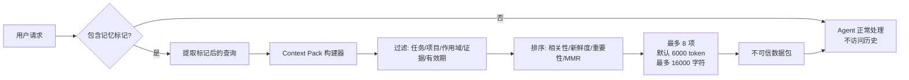
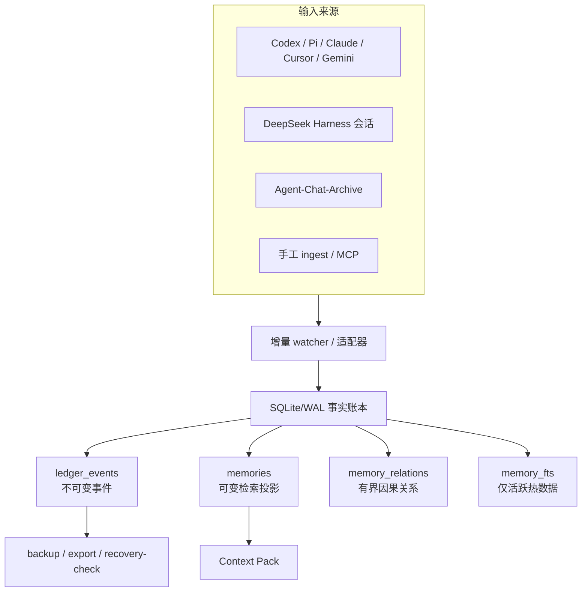
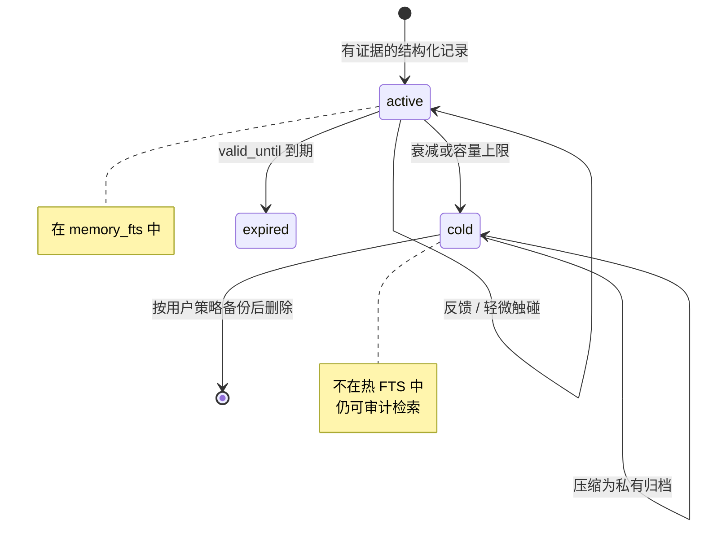
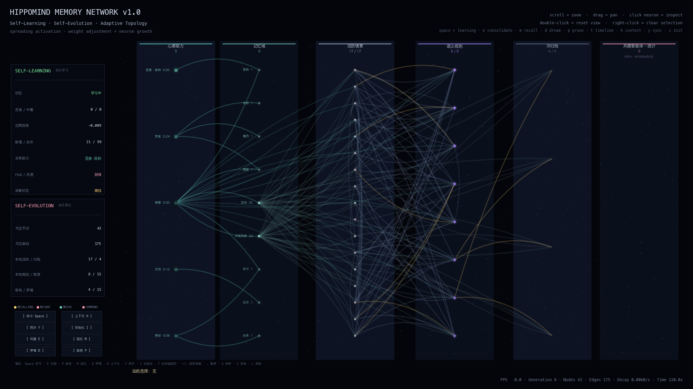
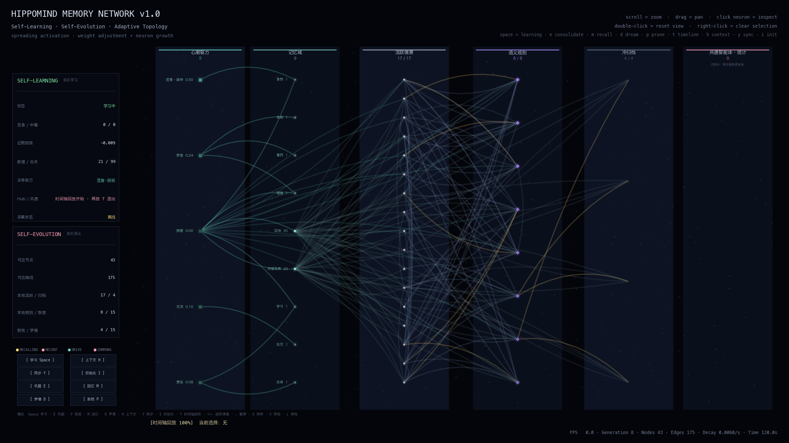

# HippoMind 详细拆解指南

这份文档面向第一次接触 HippoMind 的人。它先解释“为什么需要它”，再解释“数据怎样流动”，最后给出可以复制执行的安装、验证、排错和迁移步骤。阅读完后，你应该能回答三个问题：

1. 哪些数据会被保存，哪些数据永远不会默认注入？
2. 一个 Agent 的请求怎样得到一小段有证据的历史上下文？
3. 出错、升级、迁移或卸载时，怎样保证数据和凭据可恢复？

## 1. 一句话模型

把 HippoMind 想成 Agent 旁边的一座本机“海马体”:

- Agent 负责理解和行动。
- HippoMind 负责保存可追溯的经验、筛选当前最相关的少量事实。
- 用户通过 `记忆：` 或 `记忆:` 明确打开一次检索。
- 记忆只是**不可信参考数据**，不会变成新的系统指令。



## 2. 系统由哪些部分组成

### 2.1 事实来源：SQLite/WAL 账本

长期运行模式只把 SQLite 账本当作事实来源。每条记录至少带有来源 Agent、会话、任务、项目、作用域、角色、时间和证据引用。WAL 让 watcher、daemon 和查询者在本机并发工作时保持事务一致性。



重要边界：

| 数据 | 默认保存 | 默认进入 Context Pack | 说明 |
| --- | --- | --- | --- |
| `task` / `progress` / `decision` / `result` | 是 | 可以 | 必须通过证据和质量过滤 |
| raw chat | 是，可压缩冷归档 | 否 | 只有显式 raw 选项才允许检索 |
| tool / system / developer 转录 | 不进入共享记忆 | 否 | watcher 会过滤 |
| token / agent credential | 仅本机 0600 文件和哈希账本 | 否 | 不在导出和插件文件中输出 |

### 2.2 热 FTS 与冷审计数据

FTS5 只服务热数据。记录进入 `cold`、`expired` 或其他非活跃状态后，不再占据热索引；SQLite 账本和原始审计归档仍保留。显式审计搜索走有界的冷数据回退路径，因此“退出 FTS”不等于“删除证据”。



### 2.3 Context Pack 的选择过程

选择过程故意分成“先过滤、后排序、再裁剪”三步。这样旧的高分冲突结论、没有证据的因果父节点和其他任务的噪声不会因为分数高就穿透门禁。

1. 规范化查询并识别任务、项目和工作目录线索。
2. 应用 scope、source agent、role、时间范围、raw chat 和 `require_evidence` 过滤。
3. 用 FTS5/关键词、来源新鲜度、重要性、效用、置信度和 touch 计算候选分数。
4. 当前任务只获得一次明确的任务加分；任务主导判断使用最强匹配、前三均值和时间，不按历史条数求和。
5. 用 MMR 去掉重复表达，保留不同来源和不同类型的事实。
6. 补入有界的任务状态和因果父节点，再次过滤冲突与有效期。
7. 以 8 项、6000 token、16000 字符三个上限裁剪，并套上动态 nonce 的不可信数据边界。


## 3. 五个关键可靠性修复

### 3.1 FTS 冷数据清理

维护事务现在同时处理三类情况：

- 本轮刚刚变冷的结构化记录。
- 本轮刚刚超出活跃容量的记录。
- 旧版本遗留下来的“记忆已冷、FTS 仍在”的残留行。

维护命令必须在 daemon 停止后运行，因为它可能压缩 raw 证据并写入 WAL：

```bash
python3 -m hippomind stop
python3 -m hippomind maintain --raw-retention-days 30 --raw-capacity 5000
python3 -m hippomind start
```

### 3.2 任务排序不再奖励噪声数量

假设任务 A 有 100 条弱相关历史，任务 B 有 1 条非常准确的新状态。旧的“全部分数求和”会偏向 A；现在先比较每个任务的最强命中，再用前三命中平均值和来源时间解决真实并列。

### 3.3 因果证据门禁

因果父节点必须和主 Context Pack 使用同一套可见性合同：作用域一致、质量为 accepted、未过期、必要时拥有 evidence、且 raw chat 可见性一致。这样“父节点存在”不再自动等于“父节点可以注入”。

### 3.4 错误退避稳定性

watcher 的错误签名只使用异常类型和 errno，不把临时文件路径、行号或动态错误文本作为身份。相同故障会持续指数退避；成功后清除 streak，避免日志每次变化导致退避被重置。

### 3.5 安装失败回滚

安装器在替换前快照配置、规则、MCP profile 和 Codex hook。任一会抛错的阶段失败时：

1. 撤销本次新签发的 credential。
2. 按写入逆序原子恢复文件。
3. 保留原 credential 和旧配置继续可用。
4. 对预期不可用的 MCP/DSH 运行时使用规则或便携 profile 降级，不把可降级故障误报成半安装成功。

## 4. 安装与第一次验证

### macOS / Linux

```bash
git clone https://github.com/zps-31/hippomind.git
cd hippomind
./scripts/bootstrap.sh
.venv/bin/python -m hippomind init
.venv/bin/python -m hippomind start
.venv/bin/python -m hippomind install-agents --auto
.venv/bin/python -m hippomind doctor --deep
```

### Windows PowerShell

```powershell
git clone https://github.com/zps-31/hippomind.git
cd hippomind
.\scripts\bootstrap.ps1
.\.venv\Scripts\python.exe -m hippomind init
.\.venv\Scripts\python.exe -m hippomind start
.\.venv\Scripts\python.exe -m hippomind install-agents --auto
.\.venv\Scripts\python.exe -m hippomind doctor --deep
```

### 第一次带记忆的请求

```bash
printf '%s\n' '继续检查服务。记忆：SQLite WAL 并发限制' | \
  .venv/bin/python -m hippomind auto-context \
  --stdin --trigger-mode anywhere --cwd "$PWD" --format text
```

看到 `not_triggered` 并不代表服务坏了：它表示请求没有显式记忆标记，正是隐私默认行为。看到空 Context Pack 也可能是正确结果，因为系统不会用低相关历史填充预算。

### 推荐验收顺序

```bash
.venv/bin/python -m hippomind status
.venv/bin/python -m hippomind agent-status --agent all
.venv/bin/python -m hippomind context 'Memory Hub' --debug
.venv/bin/python -m unittest discover -s tests -v
```

## 5. 图形界面看什么

旧实验 GUI 适合观察“记忆如何升降权”，网络 GUI 适合观察“来源、任务、语义、冷归档和跨 Agent 如何连接”。两者都不是 daemon 的事实来源；关闭窗口不会删除 SQLite 账本。

### 网格世界实验



> v0.9.2 旧版截图见 images/gui-grid-world.png 与 PDF 说明书。

网格世界是一个可重复的教学环境：Agent 根据历史行动结果选择靠近食物、避开毒药，并展示权重、驱力与学习曲线。它用于理解算法，不代表生产 Agent 的完整接入路径。

### 层状记忆网络



六列节点分别代表驱力、域、活跃情景、语义规则、冷归档和全机 Agent。线条来自真实的来源、任务、亲和或因果关系，不是随机装饰。

启动方式：

```bash
./start-hippomind.command --gui
```

## 5.5 v1.0 界面与运维新能力

**全屏记忆网络（`--mode network` 或 `start-hippomind.command --network`）**

- **T 时间轴回放**：按创建时间重演记忆网络生长（约 10 秒走完全程，到末尾自动
  暂停；详情行显示回放百分比）。再按 T 退出并恢复低频刷新契约。
- **点击共通智能体层**：聚焦该 Agent——其来源记忆紫色描边、相关边提亮，
  详情行显示关联记忆计数。右键取消。
- **G 快照**：当前帧存为 `output/hippomind-network-<时间戳>.png`。

**工作台（`--mode gui`）**

- **G 快照**：当前帧存为 `output/hippomind-workbench-<时间戳>.png`。
- 页眉状态胶囊实时显示学习状态 / FPS / 记忆时钟 / 主导驱力；
  「最近事件」卡显示觅食/中毒/撞墙/移动计数、累计回报与最新梦境。

**后台自治（daemon 运行时自动进行，无需干预）**

- **睡眠巩固**：连续 10 分钟无请求且无新增导入时，自动执行一轮深维护
  （巩固 + raw 归档 + WAL 检查点），日志输出一条 `[hippomindd] 空闲巩固`。
- **热重载**：`kill -HUP <pid>` 或管理员 `POST /admin/reload` 强制重扫 Agent
  发现并触发受控自动安装——下载新 Agent 后无需重启 daemon。
- **WAL 健康**：每个维护周期末做 TRUNCATE 检查点，`-wal` 文件常态接近 0 字节。

**新 CLI 命令**

| 命令 | 用途 |
|---|---|
| `hippomind resolve --claim <id> --winner <mid>` | 手动裁决事实冲突（胜者恢复召回，败者谱系保留） |
| `hippomind facts [--subject X]` | 事实投影：活跃 claim 的结构化视图 |
| `hippomind skills` | 技能投影：procedural 记忆的触发/前置/步骤 |
| `hippomind export --out f.jsonl` / `import --in f.jsonl` | 跨机迁移（幂等去重） |
| `hippomind forget --scope X [--before ISO] [--purge]` | 隐私遗忘（软遗忘留审计；--purge 真清除） |
| `hippomind context --enable-ngram-vector` | 启用 n-gram 向量重排通道（默认关） |

### 5.6 token 预算校准（estimate_tokens）

`--max-tokens` 由 `context_pack.estimate_tokens()` 估算，公式为
tokenizer 中立的经验上界：

| 文本类型 | 估算公式 | 相对真实 BPE（cl100k 类） |
|---|---|---|
| ASCII 英文 | 字符数 ÷ 4 + 空白段数 | 偏高约 40–60%（安全方向） |
| CJK 中文 | 字符数 × 1.25 | 偏高约 25–70%（cl100k 实际 ≈0.7–1.0/字） |
| 其他非 ASCII | 字符数 ÷ 2 | 保守 |
| 代码 | 同英文规则 | 接近真实值 |

**使用建议**：
- 预算按"宁小勿大"设计——估算偏高意味着真实注入永远不会超预算；
- 若你的模型上下文紧张且以中文为主，可把 `--max-tokens` 设为目标上下文
  的 60%（例如 8K 上下文设 4800），因为真实消耗比估算低；
- 校准基准见 `tests/test_token_estimate.py`（锁定下界与 CJK 区间）。

## 6. 隐私、安全与威胁边界

### 默认保护

- daemon 只监听 `127.0.0.1`。
- 除 `/health` 外的 HTTP 请求要求本机 token。
- token 文件和 Agent 配置文件权限为 0600，数据库不保存明文 credential。
- raw chat 默认不进入 Context Pack。
- 注入内容被标记为 `<MEMORY_DATA_UNTRUSTED>`，并经过 XML 转义。
- portable export 排除 raw chat、tool/system/developer、cursor、daemon 状态和凭据。

### 不能替你保证的事情

- 同一操作系统账号下的本机账本不是 ACL 或签名服务。
- 如果操作系统账号本身已被攻破，攻击者可以读写该账号可访问的文件。
- Context Pack 是参考数据，不应替代用户对关键事实的核验。
- 公开发布的是源代码和示例图片，不应把自己的 `HIPPOMIND_HOME`、SQLite、日志或 token 放进仓库。

## 7. 备份、迁移与恢复

### 安全备份

```bash
python3 -m hippomind backup ./backup-dir
python3 -m hippomind recovery-check
```

不要在 daemon 运行时用 Finder 或普通文件复制方式复制 SQLite/WAL。恢复前停止 daemon：

```bash
python3 -m hippomind stop
python3 -m hippomind restore ./backup-dir/hippomind.sqlite
python3 -m hippomind start
```

### 跨电脑迁移

```bash
python3 -m hippomind export portable.json
# 将 portable.json 复制到新电脑后
python3 -m hippomind import portable.json
```

迁移文件是结构化事实的可移植副本，不包含本机凭据。新电脑应重新执行 `install-agents --auto`，由目标机器重新生成自己的 credential。

## 8. 常见问题

| 现象 | 原因 | 处理 |
| --- | --- | --- |
| 普通请求没有历史 | 没有 `记忆：` 标记 | 在需要回忆的查询中明确加入标记 |
| `doctor` 提示 daemon 不可达 | daemon 未启动或端口被占用 | 运行 `status`，再运行 `start`；检查 8765 |
| `agent-status` 显示 rules | 原生运行时未安装或未被检测 | 这是安全降级；安装对应 Agent 后再运行 `install-agents --auto` |
| Context Pack 为空 | 没有满足证据/作用域/有效期/相关性门禁的记录 | 使用 `context --debug` 查看过滤原因 |
| maintain 拒绝执行 | daemon 仍在运行 | 先 `stop`，维护后 `start` |
| 安装失败但旧 Agent 还能用 | 回滚已恢复旧 credential | 查看错误后重试；不要手工复制 token |
| 迁移后没有旧聊天 | raw chat 默认不导出 | 迁移结构化事实；原始聊天按隐私策略单独处理 |

## 9. 开发者入口

```bash
python3 -m unittest discover -s tests -v
python3 -m py_compile hippomind/*.py
node --check integrations/dsh-plugin/lib/index.js
git diff --check
```

核心模块：

| 模块 | 职责 |
| --- | --- |
| `hippomind/ledger.py` | SQLite/WAL、FTS、生命周期、证据和因果关系 |
| `hippomind/context_pack.py` | 过滤、排序、MMR、预算和不可信包装 |
| `hippomind/watcher.py` | 归档增量采集和稳定退避 |
| `hippomind/agent_install.py` | Agent 接入、凭据和安装回滚 |
| `hippomind/daemon.py` | localhost HTTP 服务和后台协调 |
| `hippomind/dsh_sessions.py` | DSH 会话解码与边界控制 |
| `tests/` | 单元、黑盒、并发、安装、恢复和中文路径验收 |

完整设计取舍请看 [系统设计](../MEMORY_SYSTEM_DESIGN.md)、长期运行细节请看 [Memory Hub 指南](../MEMORY_HUB_GUIDE.md)，发布检查请看 [Release Checklist](RELEASE.md)。

## 10. 版本契约

当前发布为 `v0.9.2`：Context Pack 最多 8 项，默认 6000 token，运输层最多 16000 字符；raw chat 默认不注入；SQLite/WAL 是事实来源；未知 Agent 只报告不修改；公开仓库不包含本机数据和凭据。
